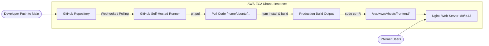

# Automated CI/CD Pipeline for React on AWS EC2 with GitHub Actions & Nginx

An automated continuous integration and continuous deployment (CI/CD) blueprint that deploys a **Node.js React** single-page application directly to an **AWS EC2 Ubuntu Server** using **GitHub Actions (Self-Hosted Runner)** and **Nginx**.

[](https://github.com/codewithmuh/github-actions-cicd-react-aws-ec2/releases)
[](https://github.com/codewithmuh/github-actions-cicd-react-aws-ec2/stargazers)
[](https://github.com/codewithmuh/github-actions-cicd-react-aws-ec2/network/members)
[](LICENSE)
[](https://react.dev)
[](https://nodejs.org)
[](https://aws.amazon.com/ec2)
[](https://github.com/features/actions)
[](https://youtube.com/@codewithmuh)
[](https://www.linkedin.com/in/muhammadrashid-daha/)

📺 **Full YouTube Walkthrough:** https://youtu.be/UK_OVKDRArs &nbsp;·&nbsp; 📝 **LinkedIn Article:** [CI/CD Pipeline for Node.js React Application Using GitHub Actions](https://www.linkedin.com/pulse/cicd-pipeline-nodejs-react-application-using-github-actions-rashid-d2svf/)


---

## 📑 Table of Contents
- [Architecture & Deployment Pipeline](#architecture--deployment-pipeline)
- [How It Works](#how-it-works)
- [Prerequisites & Security Group Rules](#prerequisites--security-groups)
- [Step-by-Step Setup Guide](#step-by-step-setup-guide)
  - [1. Launch EC2 Ubuntu Instance](#1-launch-ec2-ubuntu-instance)
  - [2. Install Node.js, NPM & Nginx](#2-install-nodejs-npm--nginx)
  - [3. Configure Nginx Virtual Host](#3-configure-nginx-virtual-host)
  - [4. Install GitHub Actions Self-Hosted Runner](#4-install-github-actions-self-hosted-runner)
  - [5. Grant Sudo Privileges & Test Pipeline](#5-grant-sudo-privileges--test-pipeline)
- [Troubleshooting & Maintenance](#troubleshooting--maintenance)
- [Author & Community](#author)
- [License](#license)

---

## 🏛️ Architecture & Deployment Pipeline



---

## ⚡ How It Works

1. A developer pushes code changes to the `main` branch.
2. The GitHub Actions workflow (`.github/workflows/cic.yml`) triggers on the self-hosted EC2 runner.
3. The runner updates the local codebase (`git pull origin main`), installs NPM dependencies (`npm install`), and builds optimized production bundles (`npm run build`).
4. The output is copied to the Nginx root directory (`/var/www/vhosts/frontend/`) and Nginx is reloaded.
5. Updates go live within seconds without manual SSH intervention!

---

## 🛡️ Prerequisites & Security Groups

Configure your EC2 Security Group with:
- **Port 22 (SSH):** Restricted to your personal IP address.
- **Port 80 (HTTP):** Open to `0.0.0.0/0` for web traffic.
- **Port 443 (HTTPS):** Open to `0.0.0.0/0` for SSL traffic.

---

## 🚀 Step-by-Step Setup Guide

### 1. Launch EC2 Ubuntu Instance
1. In the AWS Console, launch an **Ubuntu 22.04 LTS / 24.04 LTS** instance (`t2.micro` or `t3.micro`).
2. Attach your Security Group and download the `.pem` key pair.
3. Connect via SSH:
   ```bash
   ssh -i your-key.pem ubuntu@<EC2-PUBLIC-IP>
   ```

### 2. Install Node.js, NPM & Nginx
```bash
sudo apt-get update -y && sudo apt-get upgrade -y

# Setup Node.js 20.x
curl -fsSL https://deb.nodesource.com/setup_20.x | sudo -E bash -
sudo apt-get install -y nodejs npm nginx

# Verify versions
node -v
npm -v
nginx -v
```

### 3. Configure Nginx Virtual Host
1. Create the web root directory:
   ```bash
   sudo mkdir -p /var/www/vhosts/frontend/
   sudo chown -R ubuntu:ubuntu /var/www/vhosts/frontend/
   ```

2. Create the Nginx site configuration:
   ```bash
   sudo nano /etc/nginx/sites-available/react-app
   ```

3. Paste the following configuration:
   ```nginx
   server {
       listen 80;
       server_name _;

       root /var/www/vhosts/frontend/build;
       index index.html index.htm;

       location / {
           try_files $uri $uri/ /index.html;
       }
   }
   ```

4. Enable site and restart Nginx:
   ```bash
   sudo ln -s /etc/nginx/sites-available/react-app /etc/nginx/sites-enabled/
   sudo rm -f /etc/nginx/sites-enabled/default
   sudo nginx -t
   sudo systemctl restart nginx
   ```

### 4. Install GitHub Actions Self-Hosted Runner
1. In your GitHub repository, go to **Settings → Actions → Runners → New self-hosted runner**.
2. Select **Linux** and run the runner download & configuration commands on your EC2 instance.
3. Install and start the runner as a background systemd service:
   ```bash
   sudo ./svc.sh install
   sudo ./svc.sh start
   ```

### 5. Grant Sudo Privileges & Test Pipeline
To allow the runner to copy files to `/var/www/` and restart Nginx without password prompts:

```bash
echo "ubuntu ALL=(ALL) NOPASSWD: /bin/cp, /usr/sbin/service nginx restart, /bin/systemctl restart nginx" | sudo tee /etc/sudoers.d/github-actions
```

Clone the initial project into `/home/ubuntu/github-actions-cicd-react-aws-ec2`:
```bash
cd /home/ubuntu/
git clone https://github.com/codewithmuh/github-actions-cicd-react-aws-ec2.git
```

Now, every `git push origin main` will automatically build and deploy!

---

## 🔍 Troubleshooting & Maintenance

```bash
# Check runner service status
sudo ./svc.sh status

# View Nginx status & logs
sudo systemctl status nginx
sudo tail -f /var/log/nginx/error.log
```

---

## 👨‍💻 Author

**Muhammad Rashid** — Backend & Cloud DevOps Engineer, AWS Community Builder.  
- 🎥 **YouTube:** [@codewithmuh](https://youtube.com/@codewithmuh)  
- 💼 **LinkedIn:** [Muhammad Rashid](https://www.linkedin.com/in/muhammadrashid-daha/)  
- 🌐 **Website:** [codewithmuh.com](https://codewithmuh.com) · [devopsbymuh.com](https://devopsbymuh.com)

⭐ **If you find this CI/CD guide helpful, please star the repository!**

---

## 📄 License

This repository is distributed under the [MIT License](LICENSE).
